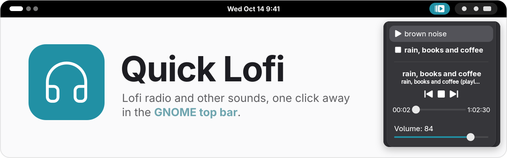
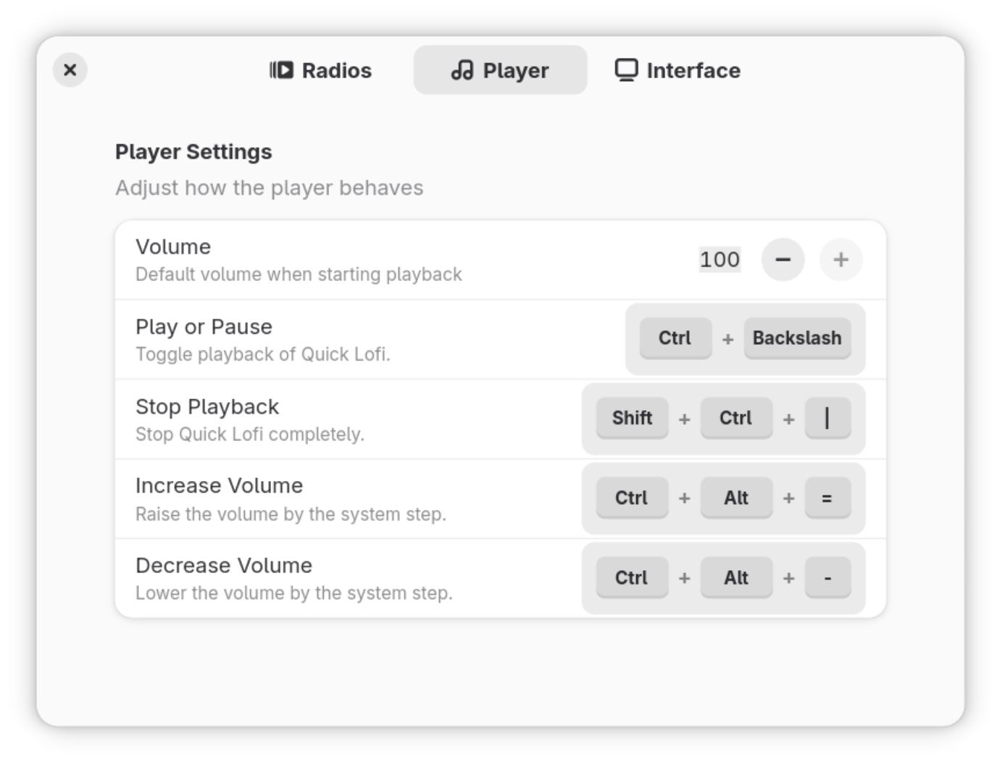

<h1 align="center">
  <a href="https://quick-lofi.eucaue.online/">
    <picture>
      <source media="(prefers-color-scheme: dark)" srcset="docs/readme/banner-dark.svg">
      
    </picture>
  </a>
</h1>

<p align="center">
  <a href="https://extensions.gnome.org/extension/6904/quick-lofi/"></a>
</p>

<p align="center">
  <a href="https://github.com/EuCaue/gnome-shell-extension-quick-lofi/releases"></a>
  
  <a href="LICENSE"></a>
  <a href="https://github.com/EuCaue/gnome-shell-extension-quick-lofi/stargazers"></a>
</p>

<p align="center">
  <a href="https://quick-lofi.eucaue.online/"><b>Website</b></a>&emsp;
  <a href="#install">Install</a>&emsp;
  <a href="#troubleshooting">Troubleshooting</a>&emsp;
  <a href="#development">Development</a>&emsp;
  <a href="https://ko-fi.com/eucaue">Ko-fi</a>
</p>

https://github.com/EuCaue/gnome-shell-extension-quick-lofi/assets/69485603/351f34da-023c-4b28-94d6-b49ca83aa34d

## What you get

- Click the icon to play or pause. Open the menu to switch stations, change the volume or skip a track.
- Any stream URL, playlist or audio file can be a station. If `mpv` plays it, Quick Lofi plays it.
- Your favorite station can start on its own when you log in or unlock the screen.
- Media keys and the GNOME media controls work, and you can add your own global shortcuts.
- Hovering over the icon shows what is playing.
- You choose what left, middle and right click do.

<p align="center">
  <picture>
    <source media="(prefers-color-scheme: dark)" srcset="docs/readme/shortcuts-dark.png">
    
  </picture>
</p>

## Install

> [!IMPORTANT]
> Quick Lofi plays everything through `mpv`. Install it first.

```bash
# Fedora
sudo dnf install mpv
```

```bash
# Debian, Ubuntu
sudo apt install mpv
```

```bash
# Arch
sudo pacman -S mpv
```

```bash
# openSUSE
sudo zypper install mpv
```

Then get the extension from [extensions.gnome.org](https://extensions.gnome.org/extension/6904/quick-lofi/), with the [browser integration](https://gnome.pages.gitlab.gnome.org/gnome-browser-integration/pages/installation-guide.html) or [Extension Manager](https://flathub.org/apps/com.mattjakeman.ExtensionManager). Updates arrive on their own that way.

<details>
<summary><b>From the release zip</b></summary>
<br>

Download `quick-lofi@eucaue.zip` from the [releases page](https://github.com/EuCaue/gnome-shell-extension-quick-lofi/releases), then run this in the same folder:

```bash
gnome-extensions install --force quick-lofi@eucaue.zip
```

Log out and back in.

</details>

<details>
<summary><b>From source</b></summary>
<br>

The newest release may not run on older GNOME versions, so check the release notes first. You need Node, npm and the GLib dev tools.

```bash
git clone https://github.com/EuCaue/gnome-shell-extension-quick-lofi.git
cd gnome-shell-extension-quick-lofi
npm install
npm run install:prod
```

Log out and back in.

</details>

## Troubleshooting

Turn on debug logs before you open an issue. They usually show the problem right away.

1. In Quick Lofi's preferences, open **Interface** and enable **Debug logging**. Or from a terminal:

   ```bash
   gsettings --schemadir "$HOME/.local/share/gnome-shell/extensions/quick-lofi@eucaue/schemas" set "org.gnome.shell.extensions.quick-lofi" "enable-debug" true
   ```

2. Make the problem happen again, then copy the log:

   ```bash
   cat /tmp/quick-lofi-$USER.log | wl-copy
   ```

   No file, or an empty one, means logging was still off.

3. [Open an issue](https://github.com/EuCaue/gnome-shell-extension-quick-lofi/issues) with what you expected, what happened, your GNOME and Quick Lofi versions, and the log.

<details>
<summary><h2 id="development">Development</h2></summary>

You need Node, npm, the GLib dev tools, `mpv` and GNOME Shell. On GNOME 49 or newer, the nested session also needs `mutter-devkit`. Run `npm run doctor` to check all of them. It prints the install command for anything missing.

### First run

Development happens on `develop`. `master` only receives releases.

```bash
git clone -b develop https://github.com/EuCaue/gnome-shell-extension-quick-lofi.git
cd gnome-shell-extension-quick-lofi

# Check system tools, install dependencies and make a dev build
npm run setup
```

### Try your changes

```bash
# Build, install and open GNOME Shell in a 1600x900 window
npm run run:dev
```

This replaces your installed copy of the extension with the dev build. Your current session keeps running the previous version until you log out, so test inside the nested window.

Calls to `debug()` from `src/shared/log.ts` print to the same terminal with the `[ QUICK LOFI DEBUG ]` prefix. Production builds remove them.

`scripts/seed-radios.json` has radios for edge cases: a working stream, YouTube, an offline tone, a broken URL, a missing file and odd names. Load them into the installed extension with:

```bash
# Add the sample radios (running it again replaces them)
npm run radios -- --add

# Remove only the sample radios
npm run radios -- --remove
```

### Test on other GNOME versions

Each supported GNOME version (45 to 51) runs headless in its own container, one at a time. It needs `podman` or `docker`.

```bash
# Run the checks on GNOME 45 and 50 (no arguments runs every version)
npm run gnome:test -- 45 50

# Open GNOME 45 in a window with your build installed
npm run gnome:open -- 45

# Delete the container images (about 1.5 GB each)
npm run gnome:clean
```

Results go to `.shell-test/<version>/`. Missing images are built on the first run. `QL_ENGINE=docker` picks docker over podman.

GitHub runs the same checks on every pull request. To run them locally, use [act](https://github.com/nektos/act) (docker only):

```bash
npm run gnome:act -- --matrix gnome:50
```

### Before you open a pull request

```bash
npm run lint
npm run typecheck
npm test
npm run build:prod
npm run shexli
```

`npm test` runs the logic tests in `tests/` with Node's test runner and does not need GNOME. `npm run check` also lints and formats, but it writes the fixes to your files.

Open the pull request against **`develop`**.

### Where things are

| Path | Contents |
| --- | --- |
| `src/extension.ts` | Entry point inside GNOME Shell |
| `src/prefs.ts` | Entry point for the preferences window |
| `src/modules/` | Shell side: indicator, player, mini player, shortcuts, MPRIS |
| `src/preferences/` | Preferences pages and widgets |
| `src/shared/` | Settings, station storage and logging, used by both sides |
| `schemas/` | GSettings keys and defaults |
| `tests/` | Tests for logic that runs without GNOME |

`dist/` and `quick-lofi@eucaue.zip` are build output. Edit the sources instead.

</details>

<br>

<p align="center">
  <a href="https://quick-lofi.eucaue.online/"></a>
</p>

<p align="center">
  <sub>Made by <a href="https://www.github.com/EuCaue">EuCaue</a>. Released under the <a href="LICENSE">GPL-3.0</a>. If it keeps you company while you work, you can support it on <a href="https://github.com/sponsors/EuCaue">GitHub Sponsors</a> or <a href="https://ko-fi.com/eucaue">Ko-fi</a>.</sub>
</p>
